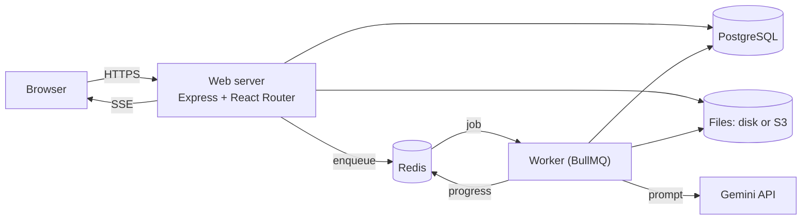

# <h1 align="center">📄 **Resume.ly** – AI-Powered ATS Resume Analyzer</h1>

<p align="center">
  <strong>An intelligent resume analysis platform that scans resumes, calculates ATS compatibility scores, and provides actionable, job-specific improvement feedback.</strong>
</p>

<p align="center">
  
  
  
  
</p>

<p align="center"> Built with ❤️ by <strong>Sakshi Singh</strong> </p>

---

## 🚀 Live Application

🔗 **Live demo:** [resumely-production-ba65.up.railway.app](https://resumely-production-ba65.up.railway.app)

Runs the web server and the worker in one container on Railway, with managed PostgreSQL and Redis. The AI runs on a free Gemini key, so heavy use may hit its daily limit and analyses will then fail with a clear message. To run it yourself or deploy elsewhere, see [docs/deploy.md](docs/deploy.md).

---

## 📌 Overview

**Resume.ly** helps job seekers bridge the gap between their experience and automated hiring systems. Over **75% of resumes** are rejected by ATS systems before ever reaching a human recruiter; Resume.ly levels the playing field.

Built with **React Router v7 on Node**, uploads are processed asynchronously by a **BullMQ worker**, persisted in **PostgreSQL**, and streamed back to the browser over **Server-Sent Events**.

### 🛠️ The Workflow
1. **Upload:** Drop your resume as a PDF (up to 20 MB).
2. **Match:** Paste the Target Job Description.
3. **Analyze:** Receive an ATS compatibility score plus scores for tone, content, structure and skills.
4. **Optimize:** Follow specific, AI-driven suggestions to improve ranking.

---

## ✨ Core Features

* **📊 Explainable ATS Engine:** Deterministic checks (layout, reading order, sections, contact info, dates, hidden text) and job-description keyword matching produce an ATS readiness score, with the evidence for every point deducted.
* **🧠 AI Feedback:** Gemini scores tone & style, content, structure and skills with specific tips. The overall score blends the engine and the AI, and the page shows the breakdown.
* **🎯 Job-Specific Feedback:** The job title and description are part of the prompt, so feedback targets the role you're applying for.
* **☁️ Private Storage:** Every resume, analysis and file is scoped to its owner; other users get a 404. You can delete any of your resumes.
* **🔐 Real Auth:** Argon2-hashed passwords and database-backed sessions in HttpOnly cookies.
* **⚙️ Durable Jobs:** Idempotent submissions, retries with backoff, error classification and crash recovery.
* **🛡️ Validated AI Output:** Model responses are checked against a Zod schema, retried once if malformed, and never saved as a fake score.
* **🚦 Abuse Protection:** Redis sliding-window rate limits on login, signup and analyses, a per-request CSP nonce and other security headers, PDF parsing timeouts.
* **🔭 Observability:** Structured JSON logs with a request id that follows an upload into the worker, `/healthz` and `/readyz`, optional Sentry.
* **🎨 Modern UI/UX:** A clean, responsive interface built with **Tailwind CSS** and **Vite** for lightning-fast interactions.

---

## 🛠️ Tech Stack

| Layer | Technology |
| :--- | :--- |
| **Frontend** | React, TypeScript, React Router v7, Tailwind CSS |
| **Server** | Node.js (React Router loaders, actions, resource routes) |
| **Database** | PostgreSQL + Drizzle ORM |
| **Queue & Worker** | BullMQ + Redis, separate Node worker process |
| **AI** | Gemini via `@google/genai` behind an `LLMProvider` interface |
| **PDF** | `pdfjs-dist` for text extraction, `@napi-rs/canvas` for thumbnails |
| **Validation** | Zod |
| **Testing & CI** | Vitest, React Testing Library, GitHub Actions |
| **Server** | Express 5 production server with security headers, pino logging |
| **Storage** | Local disk or any S3-compatible bucket |
| **Infra** | Docker, Docker Compose |

---

## 🧠 How It Works

<details>
<summary><strong>Click to view Technical Pipeline</strong></summary>

### 1️⃣ Upload
The upload action validates the file (size and `%PDF-` magic bytes), stores it under an owner-scoped key, and computes an idempotency key from the user, file hash, job title, job description, prompt version and model. A repeated submission returns the existing analysis instead of running again. The action then enqueues a job and redirects immediately.

### 2️⃣ Worker
A separate process picks up the job, extracts text and glyph positions from every page, renders a WebP thumbnail, and runs the deterministic ATS engine. It then calls Gemini at temperature 0 with the resume text in the user turn, apart from the instructions. Each step updates the analysis stage and publishes progress.

### 2️⃣b ATS engine
Pure functions over the extracted document: column and reading-order detection from text positions, section headings (fuzzy matched), contact details, date formats and ranges, page and font checks, tiny hidden text, and instruction-like phrases. Keywords come from a curated skills dictionary with aliases, split into required and nice-to-have. The same input always gives the same report. These are heuristics, not any employer's real ATS.

### 3️⃣ Validation and failures
Model output is validated with Zod. Malformed output gets one retry with the validation error. Declined or all-zero responses fail the analysis instead of saving a fake score. Transient errors (network, 429, 5xx) retry with exponential backoff; permanent ones (invalid PDF, no text layer, bad credentials) fail immediately.

### 4️⃣ Recovery
A repeatable job reconciles the database with the queue: analyses stuck in `processing` with no heartbeat are re-queued or failed.

### 5️⃣ Progress
The review page subscribes to an SSE stream (current state first, then live updates) and falls back to polling if the stream drops.
</details>

---

## 🏗️ Architecture



The upload request only validates and enqueues, so it returns quickly; the worker does the heavy work. More in [docs/architecture.md](docs/architecture.md), and the reasons behind the main choices in [docs/adr](docs/adr/README.md).

```text
resume-ly/
├── server/            # Express production server (headers, request id, logging)
├── app/
│   ├── .server/       # Server-only: db, auth, queue, storage, rate limits, LLM, jobs, PDF, ATS engine
│   ├── components/    # UI components
│   ├── routes/        # Pages and resource routes (files, SSE, health)
│   └── lib/           # Shared: Zod schema, helpers
├── worker/            # BullMQ worker entrypoint
├── evals/             # Evaluation dataset, metrics, reports
├── scripts/           # Smoke test, load test, stub Gemini
├── drizzle/           # SQL migrations
├── docs/              # Architecture, deploy guide, load test, ADRs
├── constants/         # AI prompt and response format
├── test/              # Test setup, fixtures, PDF builder
├── docker-compose.yml
└── Dockerfile
```

---

## 📈 Load Test

With the AI replaced by a stub (3 to 4 s per call), 40 analyses submitted at once on one laptop: uploads were accepted in under 350 ms (p95) with no failures, and throughput went from 32 to 60 to 120 analyses a minute as worker concurrency went 2, 4, 8. Real throughput on a free Gemini key is capped by the provider at about 5 requests a minute. Method and caveats: [docs/load-test.md](docs/load-test.md).

---

## 📏 Evaluation

The ATS engine is measured against a labeled synthetic dataset (25 resumes, 6 job descriptions): `npm run eval`. CI fails if the numbers get worse. The dataset is synthetic and the rules were tuned against it, so perfect scores mean the checks behave as designed on those cases, not that they would on real resumes. AI score consistency can be measured with your own key via `npm run eval:llm`; on `gemini-3.1-flash-lite` the recorded run gave identical scores across 5 repeats of every pair (5 runs, 37 pairs). See [evals/README.md](evals/README.md) for the method, the first run's findings, and the limits of the data.

---

## ⚙️ Getting Started

```bash
cp .env.example .env          # set SESSION_SECRET and GEMINI_API_KEY
docker compose up -d postgres redis
npm install
npm run db:migrate
npm run dev                   # http://localhost:5173
npm run worker                # in a second terminal
```

Or run everything in containers: `docker compose up --build`.

Settings are listed in [.env.example](.env.example) and explained in [docs/deploy.md](docs/deploy.md#settings). Only `DATABASE_URL`, `REDIS_URL` and `SESSION_SECRET` are always required; the worker also needs `GEMINI_API_KEY`.

```bash
npm test            # unit tests; server tests also need Postgres from compose
npm run typecheck
npm run smoke       # after npm run build: starts the production server, checks headers and health
npm run load-test   # see docs/load-test.md
```

Tests that need Redis or an S3-compatible server run when `TEST_REDIS_URL` / `TEST_S3_ENDPOINT` are set (CI sets both) and are skipped otherwise.

---

## ⚖️ Trade-offs

* **Heuristic ATS, not a real one.** No employer's ATS is public; the checks follow common parsing problems.
* **Free-tier AI.** Throughput and daily volume depend on the Gemini key's limits.
* **Own auth.** No password reset or email verification yet.
* **Two processes plus Redis and Postgres.** More to run than a single server, in exchange for fast uploads and recoverable jobs.
