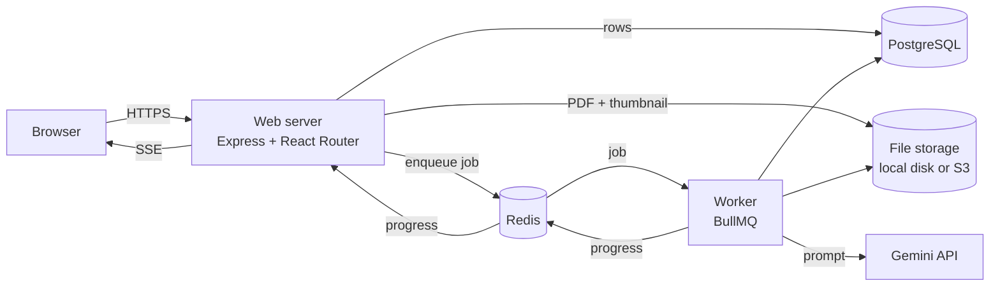
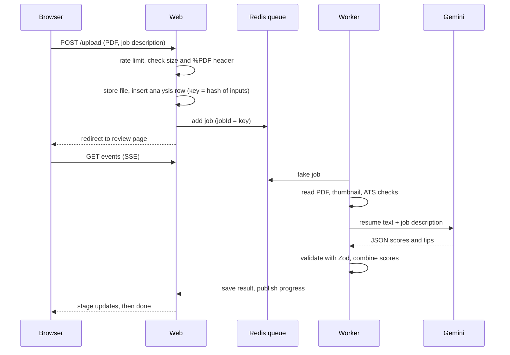

# Architecture

## Components

- **Web server** (`server/`, `app/`): an Express app wrapping React Router. It adds the request id, security headers (with a CSP nonce per request), request logging and the real client IP, then hands each request to React Router. Pages, form actions and the file and progress endpoints are React Router routes.
- **Worker** (`worker/`, `app/.server/jobs/`): a separate process that takes jobs from the queue and does all heavy work: reading the PDF, rendering the thumbnail, the ATS checks and the AI call.
- **PostgreSQL** holds users, sessions, resumes and analyses (Drizzle migrations in `drizzle/`).
- **Redis** carries the BullMQ queue, progress messages and the rate-limit counters.
- **File storage** keeps uploaded PDFs and thumbnails behind a small `StorageDriver` interface, with a local-disk and an S3-compatible implementation.

## Life of an upload

1. The upload action checks the user, the rate limit, the size and the PDF magic bytes. It stores the file under a key scoped to the owner.
2. The analysis row's idempotency key is a hash of the user, file, job text, prompt version and model. Submitting the same thing twice returns the existing analysis. The same key is the queue job id, so a duplicate enqueue is ignored.
3. The page redirects at once. The review page opens an SSE stream that sends the current state first, then live updates, and falls back to polling.
4. The worker moves the analysis through stages (reading, checking, scoring), updates the database and publishes each change.
5. The final score blends three parts: parseability from the ATS checks (30%), keyword match (30%) and the AI's quality scores (40%). Without a job description the keyword part is dropped and the others are rescaled. The page shows every part and the evidence behind each deduction.

## Failures and recovery

- Errors are classified. **Transient** ones (network, 429 with a retry delay, 5xx) are retried with backoff that honors the provider's retry delay. **Permanent** ones (not a PDF, no text, bad key, daily quota used up, parse timeout) fail at once with a message.
- A repeatable job in the worker finds analyses stuck in `processing` with no recent heartbeat and re-queues or fails them.
- Rate limiting and progress publishing fail open: if Redis hiccups, requests still work.

## Request and job tracing

Every request gets an id (the incoming `x-request-id` if it looks safe, else a new one). It is logged with each request line, stored on the queue job, and added to the worker's log lines for that analysis, so one id finds the whole story.

## Where things live

| Path | What |
|---|---|
| `server/` | Express app and production entrypoint |
| `app/routes/` | Pages, actions, health checks, file and SSE routes |
| `app/.server/` | Server-only code: auth, accounts, db, storage, queue, rate limits, logging, jobs, LLM, PDF |
| `app/.server/ats/` | The ATS engine: layout, sections, contact, dates, keywords, scoring |
| `worker/` | Worker entrypoint |
| `evals/` | Evaluation dataset, metrics and reports |
| `scripts/` | Smoke test, load test, stub Gemini |
| `drizzle/` | SQL migrations |
